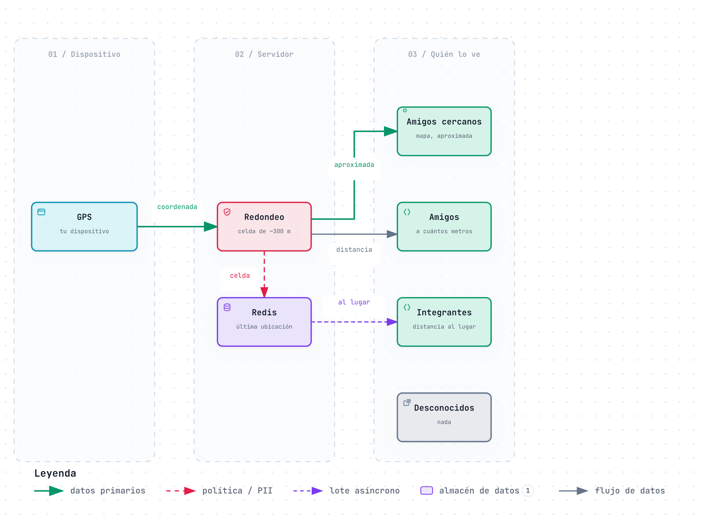
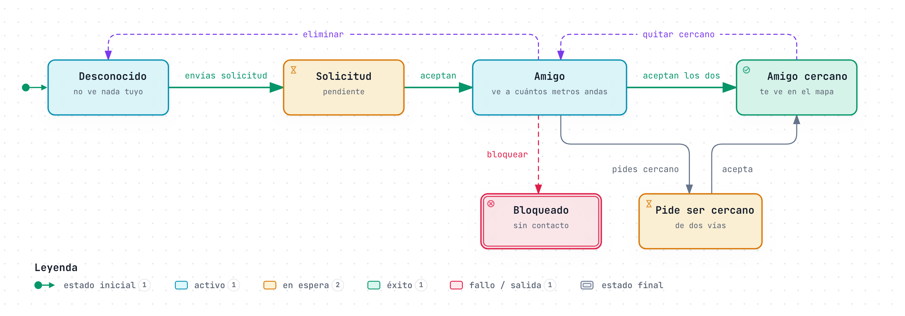
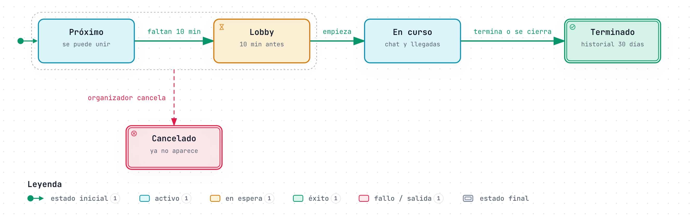
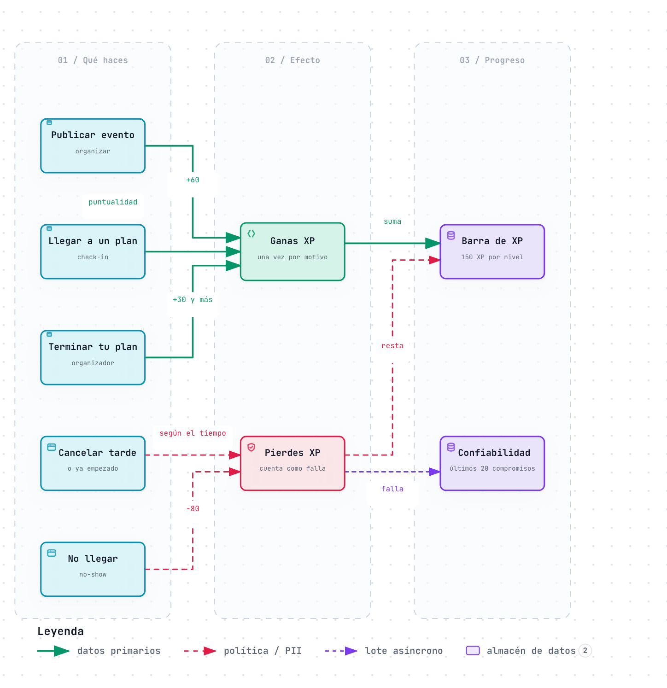
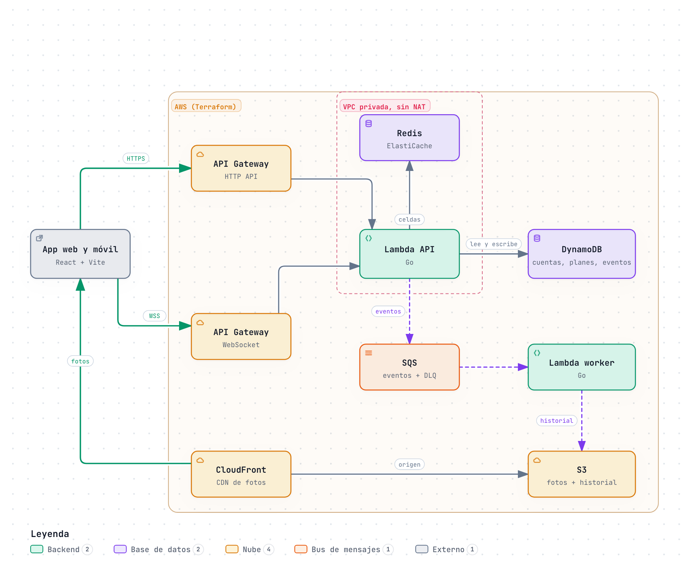
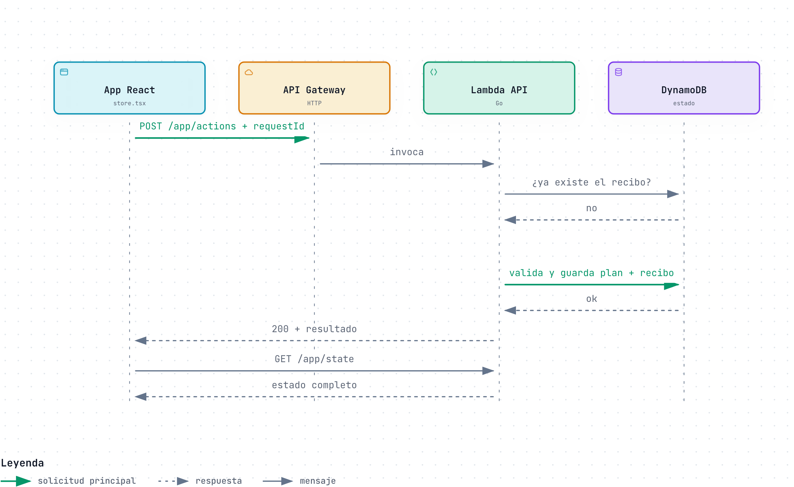
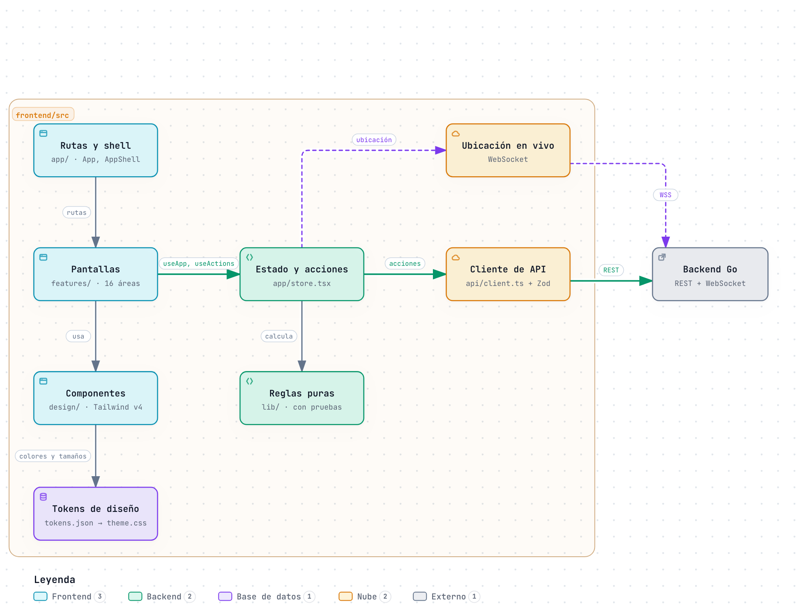
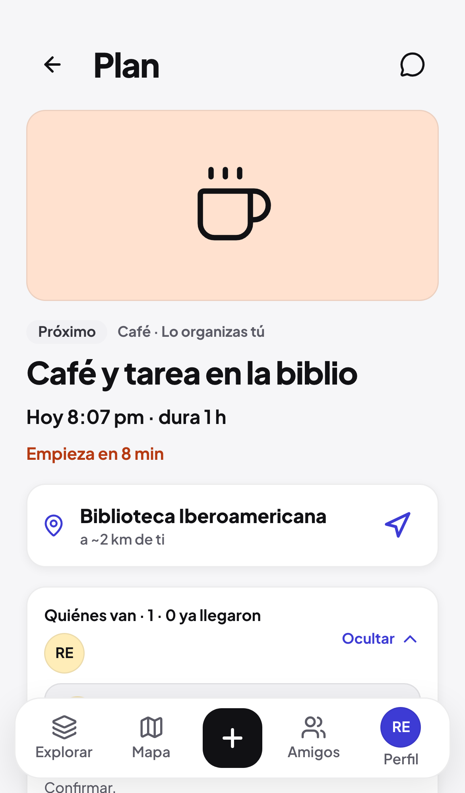
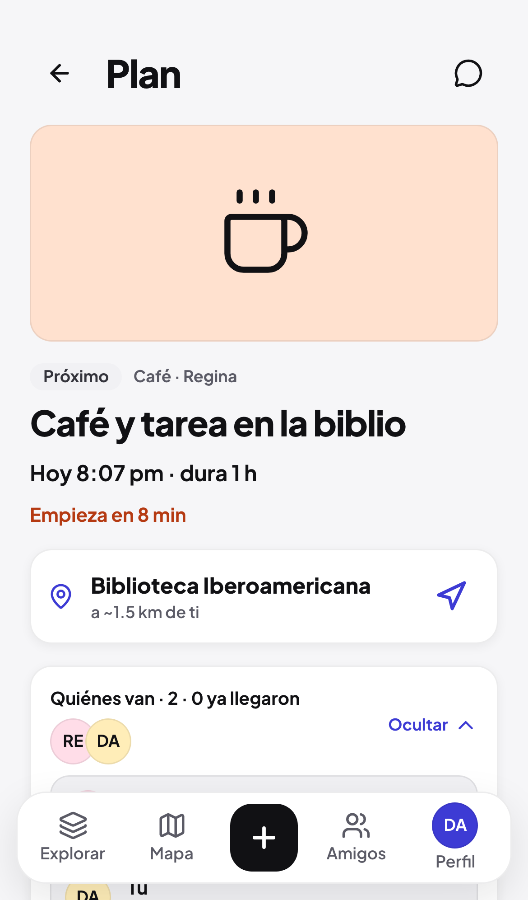
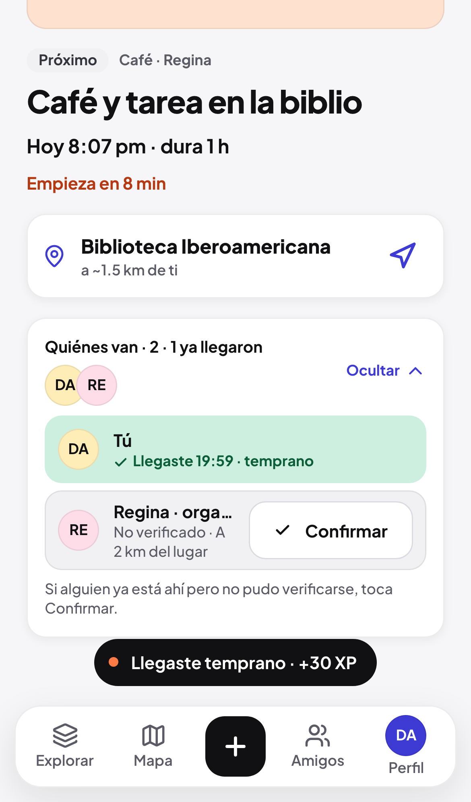

# ¿Jalas? (Friends Nearby)

Una app para ver qué amigos andan cerca y armar planes con ellos, sin exponer la ubicación de nadie más de lo que decida.

> **Written for:** personas nuevas en el proyecto (equipo o evaluadores) que necesitan entender qué hace el sistema,
> sus reglas y cómo se conectan las piezas.

## Documentación

- **[frontend/README.md](frontend/README.md):** pantallas en celular y escritorio, tecnologías, flujos de la interfaz y estructura del código.
- [backend/README.md](backend/README.md): API en Go, runner local y pruebas.
- [backend/docs/FRONTEND_INTEGRATION.md](backend/docs/FRONTEND_INTEGRATION.md): contrato entre frontend y backend.
- [frontend/docs/especificacion.md](frontend/docs/especificacion.md): especificación de producto vigente (manda sobre el brief).
- [infra/README.md](infra/README.md): infraestructura en AWS con Terraform.
- [docs/evidence/](docs/evidence/README.md): capturas de la app (celular y escritorio), de los flujos y de la infraestructura.
- [docs/diagrams/](docs/diagrams/): diagramas de arquitectura y de reglas (HTML interactivo y PNG), hechos con Archify.

## Estructura del repositorio

```
friends_nearby/
├── frontend/   React + TypeScript + Vite + Tailwind v4
├── backend/    Go: lógica de negocio (Lambdas) y runner local (cmd/local)
└── infra/      Terraform: API Gateway, Lambda, Redis, DynamoDB, SQS, S3, CloudFront
```

## Cómo funciona, en corto

Hay dos ideas separadas:

- **Cercano:** estás físicamente cerca de alguien. Lo calcula el sistema con tu ubicación **aproximada**.
- **Disponible:** tienes ganas de hacer algo. Lo eliges tú. La app nunca deduce una cosa de la otra.

Con eso la app ofrece tres cosas:

1. **Planes:** quedadas rápidas (un café, correr, jugar) que publicas y a las que tus amigos se unen.
2. **Eventos:** actividades públicas, con cupo, a las que se entra con el modo abierto.
3. **Amigos y XP:** tu red de amigos, tu progreso (niveles) y tu historial de puntualidad.

## Privacidad: quién ve qué

| Dato | Quién lo ve | Precisión |
|---|---|---|
| Tu ubicación en el mapa | Solo **amigos cercanos mutuos**, dentro de tu radio de visibilidad (3 km por defecto) | Aproximada (celda de ~300 m) |
| Tu ubicación exacta | Solo el amigo cercano que tú elijas, por 30 min, 1 h, 2 h o 4 h | Exacta, se apaga sola |
| Distancia a un plan | Integrantes de **ese** plan, desde 10 min antes del inicio y hasta que haces check-in | Redondeada a 50 m, sin coordenadas |
| Lugar de un plan o evento | Quien puede ver el plan o evento | Exacta (es un punto de encuentro, no la casa de nadie) |
| Que llegaste | Integrantes del plan o evento | Sí/no y hora; no se guarda el punto |
| Tu distancia para un **amigo normal** | Tus amigos | Solo "a 100 m · ahora", redondeado a 100 m; **nunca en el mapa** |
| Tú para quien **no es tu amigo** | Nadie | Nunca ve tu ubicación. Solo te ve dentro de un plan al que te invitó un amigo, sin mapa |



Reglas duras (las aplica el servidor):

- **Sin pausa.** No existe "pausar". Al desconectarte, tus amigos ven tu **última ubicación** con "hace cuánto".
- **Ubicación fuera de analítica y logs.** Las notificaciones push nunca dicen dónde estás ("Mau está cerca").
- **Anti-triangulación:** las distancias se calculan desde la celda redondeada, no desde el punto real.
- **Sin zonas ni colonias.** La ubicación nunca se muestra como barrio.

## Relaciones entre personas

| Relación | Cómo se llega | Qué puede hacer |
|---|---|---|
| **Desconocido** | Por defecto | Nada. No ve tu ubicación ni tus planes |
| **Solicitud** | Mandas solicitud por usuario o nombre | La otra persona acepta o rechaza |
| **Amigo** | Aceptan la solicitud | Ve tus planes y tu distancia aproximada (a cuántos metros andas) |
| **Amigo cercano** | Lo piden los dos aparte y los dos aceptan (de dos vías) | Ve tu ubicación aproximada en el mapa, dentro de tu radio. Puedes compartirle tu ubicación exacta por un tiempo |
| **Invitado de un plan** | Un amigo te invita y aceptas | Ves el plan y a sus integrantes dentro de ese plan, nada más |
| **Bloqueado** | Lo bloqueas | Se rompen las relaciones y no hay contacto. Se puede reportar a alguien |



Los amigos pueden invitar a sus propios amigos a un plan cuando la política lo permite (ver "Planes").

## Planes

Un plan es una quedada rápida: categoría (café, comer, correr, estudiar, gym, chill, fiesta, juegos), una línea de descripción, hora de inicio, duración (5 min a 24 h), lugar exacto en el mapa y cupo opcional.

**Quién puede unirse** (lo elige quien publica):
- **Tus amigos:** solo tus amigos lo ven y se pueden unir.
- **Amigos e invitados:** tus amigos lo ven; cada integrante puede invitar a sus propios amigos, que entran por invitación y no salen en el mapa.

**Ciclo de vida:**

| Fase | Qué pasa |
|---|---|
| **Próximo** | Visible para quien puede verlo. Se puede unir (si hay cupo). Quien organiza puede cambiar hora o lugar |
| **Lobby** (10 min antes) | Se abre el check-in. Ya puedes ver quién llegó |
| **En curso** | Se puede unir tarde si quien organiza lo permite ("Unirse tarde"). Chat abierto |
| **Terminado** | Ya no se puede unir. Queda en el historial 30 días, con su chat |



**Llegar al plan (check-in):** a menos de **250 m** del lugar, desde 10 min antes del inicio. Si el GPS falla, otra persona del plan puede confirmar tu llegada. Quien organiza también puede confirmar a alguien.

**Otras acciones:**
- **Mensajes rápidos:** "Ya voy", "Llego en 5", "Llego en 10", "Voy tarde", "Ya estoy aquí", "¿Dónde están?".
- **Chat del plan:** 280 caracteres, un mensaje por segundo, cinco temas de color. Cada quien borra sus mensajes; quien organiza borra cualquiera.
- **Cambios:** quien organiza cambia hora o lugar. Cancelar tu lugar en las 2 h siguientes a un cambio no penaliza.
- **Terminar ahora:** quien organiza cierra un plan en curso y se conserva lo que duró.
- **Cancelar:** quien organiza cancela el plan; deja de aparecer para todos.
- **Quedar de verse:** si dos personas confirman que se vieron, ganan XP.

**Regla de penalización:** si quien organiza no marcó llegada pero alguien más sí llegó, el plan se considera hecho y **no** se le penaliza por no llegar.

## Eventos

Los eventos son públicos y ocupan el lugar que se ve en el mapa. Son más formales que un plan.

- **Modo abierto obligatorio.** Para crear o unirte a un evento necesitas el modo abierto activo y ser mayor de 18 años. Si no lo tienes, la app te lleva a activarlo.
- **Tipos:** juegos, comida, clase, deporte, música, arte, otro. "Otro" permite nombre, ícono y color propios para ese evento.
- **Datos:** nombre (3–100 caracteres), descripción (hasta 1000), lugar, fecha y horas (si termina antes de empezar, termina al día siguiente), cupo de 2 a 200, foto opcional, alias de organizador opcional.
- **Entrada:** directa o con aprobación de quien organiza ("Pedir unirme"). Se puede unir tarde si el evento lo permite.
- **Quien organiza:** puede editar, cancelar, publicar hasta 20 avisos de 500 caracteres, activar o apagar el chat (apagado por defecto) y borrar mensajes.
- **Llegada:** check-in por ubicación, igual que en planes (250 m, desde 10 min antes). La verificación por QR existe en el backend, pero la interfaz no la usa.

## XP, niveles y puntualidad

El XP es el progreso de cada persona. Los niveles van del 1 al 100, con **150 XP por nivel**. Cada 10 niveles cambia el tramo (Barrio, Colonia, Ruta, Pista, Escena, Sabiduría, Cielo, Titanes, Realeza, Mito) con su propia forma e insignia.



**Cómo ganas XP:**

| Acción | XP |
|---|---|
| Publicar un evento (organizar) | +60 |
| Tu entrada a un evento aceptada | +40 |
| Por cada persona que se une a tu evento | +5 (para quien organiza) |
| Por cada persona que llega a tu evento | +5 (para quien organiza) |
| Llegar a un plan (check-in): temprano / a tiempo / tarde / muy tarde | +30 / +20 / +12 a +8 / +5 |
| Terminar tu plan | +30, más +5 por cada persona que llegó (máx. +25) |
| Quedar de verse con alguien y confirmarlo | +20 cada uno |

**Cómo pierdes XP:**

| Situación | XP |
|---|---|
| Cancelar tu lugar más de 90 min antes | −10 |
| Cancelar entre 90 y 15 min antes | −25 a −50 (sube conforme se acerca) |
| Cancelar menos de 15 min antes | −60 y cuenta como falla |
| Cancelar después de que empezó, sin haber llegado | −100 y cuenta como falla |
| Confirmaste y no llegaste (no-show) | −80 y cuenta como falla |
| Quien organiza cancela un plan con gente ya dentro | Misma tabla, según el tiempo |

Si el XP no alcanza, se resta de tu nivel. Con 1 de nivel y sin XP puedes bajar a nivel 0 ("Bajo tierra") y después a niveles negativos (hasta −9, "Bajo cero"). Con 10 XP vuelves al nivel 1. Es un easter egg, no una pérdida permanente.

**Confiabilidad:** se guardan tus últimos 20 compromisos como cumplido o falla.

## Notificaciones

Llegan dentro de la app (no hay push todavía). Se agrupan en **Hoy / Esta semana / Antes** y lo que pide respuesta (invitaciones, solicitudes, pedidos de ubicación exacta) se responde desde la misma pantalla. Tienes preferencias por tipo.

Tipos: invitaciones, solicitudes de amistad o de amigo cercano, pedido de ubicación exacta, unión y llegada a tu plan, mensajes del chat, cambio de hora o lugar, "tu plan empieza en X min", "está cerca" (solo amigos cercanos mutuos, una vez al día por persona).

## Modo abierto

Es el interruptor para ver y unirte a eventos de personas que no son tus amigos. Requiere ser adulto (18+). Apagarlo no borra tus asistencias existentes en "Mis planes".

## Hora

Todo se muestra y se calcula en hora de **Ciudad de México** (`America/Mexico_City`), sin importar la zona del dispositivo (`frontend/src/lib/tz.ts`). El servidor guarda y manda instantes en UTC.

## Arquitectura



| Pieza | Para qué sirve |
|---|---|
| **App React** | Interfaz web y móvil. Solo pinta lo que el servidor manda |
| **API Gateway HTTP** | Entrada REST: `POST /app/actions` (acciones) y `GET /app/state` (estado) |
| **API Gateway WebSocket** | Solo ubicación en vivo |
| **Lambda API (Go)** | Todas las reglas: permisos, horarios, cupos, XP, privacidad |
| **Redis (ElastiCache)** | Última ubicación en celdas redondeadas, con TTL |
| **DynamoDB** | Cuentas, amistades, planes, eventos y recibos de acciones |
| **SQS y Lambda worker** | Eventos de ubicación en segundo plano; el historial se agrupa en S3 |
| **S3 y CloudFront** | Fotos de planes y perfiles, y el historial en lotes |

La Lambda y Redis viven en una VPC privada sin NAT. Todo se despliega con Terraform (`infra/`). Los detalles y la captura del diagrama del README de infra están en [infra/README.md](infra/README.md).

### Cada acción es idempotente



Cada acción lleva un `requestId`. Si la red falla y la app reintenta, el servidor devuelve el mismo resultado en vez de repetir la acción. Si llega el mismo `requestId` con otro contenido, responde 409.

### Frontend



Cómo está organizado el código y cada pantalla: [frontend/README.md](frontend/README.md).

## Flujo típico

1. **Registro** y **permiso de ubicación** (o ubicación manual).
2. **Explorar** muestra planes y eventos cercanos; cada tarjeta se puede pasar, guardar para después o unirte.
3. **Agregas amigos** y, si quieren, se hacen amigos cercanos.
4. **Publicas un plan** (o un evento, con modo abierto). Tus amigos lo ven en su mapa y en Explorar.
5. **Te unes** ("Jalo") o te invitan. El plan aparece en "Mis planes" y en el banner de "próximo".
6. **10 min antes**, se abre el check-in. Llegas, haces check-in y ganas XP.
7. **Terminan** el plan: se suma XP a quien organizó y a quien llegó. Queda en el historial.

| Se publica | Un amigo se une | Lobby | Check-in y XP |
|---|---|---|---|
|  |  |  |  |

Todas las capturas están en [docs/evidence/](docs/evidence/README.md).

## Ejecutar

```bash
# backend/
docker compose up -d
go run ./cmd/local

# frontend/
cp .env.example .env
npm ci
npm run dev
```

Abrir http://localhost:5173 y registrar una cuenta. Para desplegar: `infra/scripts/build-lambdas.sh` y luego `terraform apply` en `infra/`.

## Pruebas

- **Frontend:** `npm test` (Vitest; fija `TZ=America/Mexico_City`). `npm run test:e2e` (Playwright en iPhone, Pixel y escritorio, con el backend local arriba).
- **Backend:** `go test ./...`.

## Evidencia

La carpeta [docs/evidence/](docs/evidence/README.md) reúne 60 capturas de la app con datos de demostración:

- 25 pantallas en celular (iPhone 14) y 25 en escritorio (1440 × 900).
- 10 capturas de dos flujos paso a paso: un plan y un evento.
- El diagrama de infraestructura del README de infra.

Se regeneran con `npm run evidence` desde `frontend/` (ver [docs/evidence/README.md](docs/evidence/README.md)). Los diagramas de `docs/diagrams/` se hicieron con Archify; sus fuentes JSON están en `docs/diagrams/src/`.
