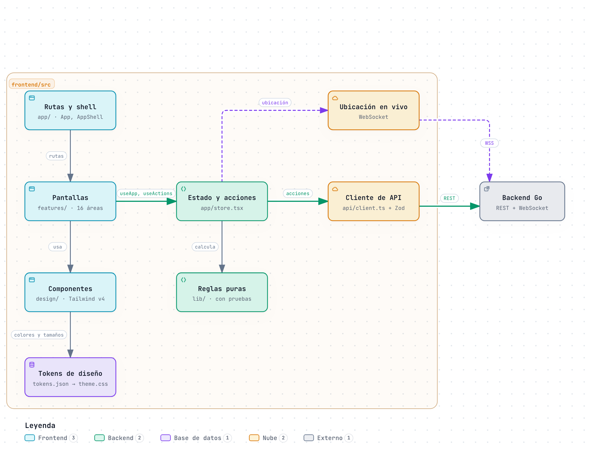

# ¿Jalas? — frontend

Interfaz de la app: móvil primero (390 px) y escritorio desde 1024 px. Conectada al backend Go.

> **Written for:** personas que van a tocar el frontend por primera vez. Explica qué ve cada pantalla, cómo se
> conectan los flujos y dónde vive cada cosa en el código. Las reglas del producto están en el
> [README raíz](../README.md); la especificación vigente, en [docs/especificacion.md](docs/especificacion.md).

## Tecnologías

| Área | Herramienta |
|---|---|
| UI | React 19 + TypeScript (modo estricto) |
| Build y dev server | Vite 8 |
| Estilos | Tailwind CSS v4 (`@tailwindcss/vite`), tokens en `docs/design/theme.css` |
| Rutas | React Router 7 |
| Mapa | MapLibre GL + react-map-gl (base de CARTO) |
| Validación de datos | Zod 4 (todo lo que llega del servidor se valida) |
| Íconos | lucide-react |
| QR | qrcode |
| Pruebas unitarias | Vitest 5 |
| Pruebas E2E | Playwright (iPhone 14, Pixel 7, escritorio 1440 × 900) |
| Accesibilidad | axe-core (`@axe-core/playwright`) |

## Ejecutar

Desde `backend/`, levanta dependencias y el servidor local:

```bash
docker compose up -d
go run ./cmd/local
```

Desde `frontend/`:

```bash
cp .env.example .env     # VITE_API_URL=http://localhost:8080, VITE_WS_URL=ws://localhost:8080/ws
npm ci
npm run dev              # http://localhost:5173
```

Ningún secreto debe ir en variables `VITE_*`: quedan en el navegador.

## Pruebas

```bash
npm run typecheck        # tsc -b
npm test                 # Vitest, con TZ=America/Mexico_City
npm run build
npm run test:e2e         # requiere el backend local y Chromium de Playwright
npm run evidence         # regenera docs/evidence (ver docs/evidence/README.md)
npm run diagrams         # convierte docs/diagrams/*.html a PNG
```

Para instalar Chromium de Playwright: `npx playwright install chromium`.

La suite `e2e/integration` crea cuentas reales contra el backend. Las pruebas E2E más antiguas (`e2e/*.spec.ts` fuera de
`integration`) corren sobre datos de mock y sirven como referencia de diseño; algunas esperan textos anteriores y se
actualizan al final de cada bloque.

## Pantallas

Cada pantalla existe en celular (columna de 480 px con la barra inferior) y en escritorio (barra lateral de 220 px).
Las rutas de la tabla salen de `src/app/App.tsx`.

### Acceso y arranque

| Ruta | Pantalla | Celular | Escritorio |
|---|---|---|---|
| `/entrar` | Entrar, registrarse y recuperar contraseña | Formulario en una columna | Formulario centrado con el mensaje de seguridad |
| `/permiso` | Permiso de ubicación (o elegir ubicación a mano) | Explica qué se comparte y qué no, con dos botones | Igual, centrado |
| `/legal` | Términos y aviso de privacidad | Texto en una columna | Texto con ancho de lectura |

Los guardas de ruta (`RequireAuth`, `RequireLocation` en `src/app/AppShell.tsx`) mandan a `/entrar` sin sesión y a
`/permiso` si todavía no has decidido tu ubicación.

### Explorar (`/`)

- **Celular:** encabezado con "Hoy" (o el día que elijas), esquina izquierda "Mis planes" (con punto si hay uno en
  curso) y derecha "Notificaciones" con su número. Debajo, chips de día y una pila de tarjetas que se deslizan: pasar,
  guardar para después o unirte. Abajo, la barra de navegación.
- **Escritorio:** layout ancho con las mismas tarjetas en cuadrícula y los filtros arriba (`DesktopExplore.tsx`).
- Código: `features/explore/` (`ExploreDeck`, `DayChips`, `PlanTodayHeader`, `cards.tsx`, `useDeck.ts`).

### Mapa (`/mapa`)

- **Celular:** mapa a todo el ancho. Encima, la leyenda de capas, la hoja del elemento seleccionado (plan, evento o
  persona) y el botón de ajustes de radio. Hay una lista equivalente del mapa para lectores de pantalla y para quien no
  quiere usar el mapa.
- **Escritorio:** mapa ancho con la misma hoja y la lista lateral.
- Capas: amigos cercanos (avatar sin nombre, ubicación aproximada), planes (ícono de la actividad, lugar exacto) y
  eventos (forma distinta, lugar exacto). Un grupo de marcadores muy cerca se agrupa en `ClusterSheet`.
- Código: `features/map/` (`MapView`, `MapList`, `MapLegend`, `SelectedSheet`, `useMapData.ts`).

### Publicar (`/publicar` y `/publicar/evento`)

- **Plan rápido (`/publicar`):** categoría, una línea, cuándo empieza (ahora, en 30 min, en 1 h, otra hora u otro
  día), duración, lugar en el mapa, foto, cupo, "unirse tarde", invitados y quién puede unirse.
  - **Celular:** banner de vista previa fijo arriba mientras llenas el formulario.
  - **Escritorio:** formulario a la izquierda y tarjeta de vista previa a la derecha (340 × 410 px).
- **Evento (`/publicar/evento`):** requiere modo abierto; si no lo tienes, la pantalla muestra el selector y el botón
  para activarlo. Tipo (con "Otro" para nombre, ícono y color propios), nombre, descripción, fecha, hora de inicio y fin,
  lugar, alias, foto, cupo (escrito a mano, de 2 a 200), unirse tarde, invitados, aprobación y chat.
  - El selector **Plan rápido / Evento** es el mismo en las dos pantallas (`PublishTabs.tsx`).
  - Escritorio: la misma estructura de dos columnas que Plan rápido.

### Amigos (`/amigos`)

- Pestañas **Amigos** (buscar personas, link o QR para agregarte, solicitudes de amistad y de amigo cercano) y **Ranking** (global y de amigos, `?tab=ranking`).
- Celular: lista a todo el ancho. Escritorio: lista con ancho máximo de 640 px.
- Código: `features/friends/`.

### Planes (`/planes`) y plan (`/plan/:id`)

- `/planes`: pestañas **Próximos**, **En curso**, **Pasados** y **Cancelados**.
- `/plan/:id`: banner del plan (foto o ícono, hora, lugar), mapa con el punto de encuentro, quién va, acciones
  (Jalo, Ya llegué con check-in, confirmar llegada, mensajes rápidos, terminar, editar, cancelar) y chat.
  - Celular: la barra inferior sigue visible.
  - Escritorio: el banner y el mapa a la izquierda, acciones y chat a la derecha.
- Código: `features/plans/` (`PlanScreen`, `PlansScreen`, `ChatPanel`, `UpcomingBanner`, `useMyPlans.ts`).

### Evento (`/evento/:id`)

- Hero con la foto (o el color del tipo) y cuánto falta. Descripción, avisos, chat (si quien organiza lo activó),
  quién organiza (tocable) y quién va.
- Acciones: Me uno, Pedir unirme, Salirme, Ya llegué (abre 10 min antes), editar y cancelar (solo quien organiza).
- Celular: una columna. Escritorio: el hero a la izquierda y las acciones a la derecha.
- Código: `features/events/` (`EventScreen`, `EditEventSheet`, `OpenModeSheet`).

### Notificaciones (`/notificaciones`)

- Agrupadas en **Hoy / Esta semana / Antes**. Las que piden respuesta (invitaciones, solicitudes, pedidos de ubicación)
  se contestan ahí mismo. Se pueden eliminar con deshacer de 6 segundos.
- Celular: lista en una columna, con "Marcar leído" y "Eliminar todas" arriba.
- Escritorio: lista a la izquierda y panel de resumen a la derecha (pendientes y botones).
- `/notificaciones/preferencias`: qué avisos recibir.
- Código: `features/notifications/`.

### Perfil (`/perfil`, `/perfil/editar`, `/perfil/nivel`, `/u/:id`)

- `/perfil`: foto, nombre, handle, bio, planes y eventos, y el menú (privacidad, modo abierto, preferencias de notificaciones, legal y editar perfil).
  El avatar lleva a tu perfil desde la barra inferior o la lateral.
- `/perfil/editar`: nombre, usuario, bio, foto y contraseña.
- `/perfil/nivel`: pestañas **Progreso** (nivel actual, barra y XP), **Niveles** (los 100 niveles con su insignia) e
  **Historial** (XP ganado y perdido). Celular: columna. Escritorio: ancho de lectura.
- `/u/:id`: perfil de otra persona, con la relación que tienes (amigo, cercano, invitado) y lo que se puede hacer.
- Código: `features/profile/`.

### Privacidad y modo abierto

- `/privacidad` (**Amigos cercanos**): lista de amigos cercanos, quién te ve, radio de visibilidad y compartir
  ubicación exacta por 30 min, 1 h, 2 h o 4 h. Celular: columna. Escritorio: lista con ancho de lectura.
- `/modo-abierto`: activar o apagar el modo abierto (18+). Explica qué ven los demás.
- `/guardados`: planes y eventos que guardaste, con su estado.
- Código: `features/privacy/`, `features/open-mode/`, `features/saved/`.

### Solo desarrollo

- `/dev/ui`: galería de componentes del sistema de diseño (`features/dev/DevUi.tsx`). No se enlaza desde la app.

## Capturas

Todas están en [`../docs/evidence/`](../docs/evidence/README.md) (celular: iPhone 14; escritorio: 1440 × 900). Se regeneran con `npm run evidence`.

| Pantalla | Celular | Escritorio |
|---|---|---|
| Explorar | [04](../docs/evidence/app/mobile/04-explorar.png) | [04](../docs/evidence/app/desktop/04-explorar.png) |
| Mapa | [05](../docs/evidence/app/mobile/05-mapa.png) | [05](../docs/evidence/app/desktop/05-mapa.png) |
| Publicar plan | [06](../docs/evidence/app/mobile/06-publicar-plan.png) | [06](../docs/evidence/app/desktop/06-publicar-plan.png) |
| Crear evento | [07](../docs/evidence/app/mobile/07-publicar-evento.png) | [07](../docs/evidence/app/desktop/07-publicar-evento.png) |
| Amigos y ranking | [08](../docs/evidence/app/mobile/08-amigos.png), [09](../docs/evidence/app/mobile/09-ranking.png) | [08](../docs/evidence/app/desktop/08-amigos.png), [09](../docs/evidence/app/desktop/09-ranking.png) |
| Mis planes | [10](../docs/evidence/app/mobile/10-mis-planes.png) | [10](../docs/evidence/app/desktop/10-mis-planes.png) |
| Plan | [11](../docs/evidence/app/mobile/11-plan-detalle.png) | [11](../docs/evidence/app/desktop/11-plan-detalle.png) |
| Evento (otra persona y propio) | [12](../docs/evidence/app/mobile/12-evento-detalle.png), [13](../docs/evidence/app/mobile/13-evento-propio.png) | [12](../docs/evidence/app/desktop/12-evento-detalle.png), [13](../docs/evidence/app/desktop/13-evento-propio.png) |
| Notificaciones | [14](../docs/evidence/app/mobile/14-notificaciones.png) | [14](../docs/evidence/app/desktop/14-notificaciones.png) |
| Perfil y nivel | [16](../docs/evidence/app/mobile/16-perfil.png), [18](../docs/evidence/app/mobile/18-nivel-progreso.png) | [16](../docs/evidence/app/desktop/16-perfil.png), [18](../docs/evidence/app/desktop/18-nivel-progreso.png) |
| Amigos cercanos (privacidad) | [21](../docs/evidence/app/mobile/21-privacidad-amigos-cercanos.png) | [21](../docs/evidence/app/desktop/21-privacidad-amigos-cercanos.png) |
| Modo abierto | [22](../docs/evidence/app/mobile/22-modo-abierto.png) | [22](../docs/evidence/app/desktop/22-modo-abierto.png) |

Flujos paso a paso: [plan](../docs/evidence/flows/plan/) y [evento](../docs/evidence/flows/evento/).

## Barra de navegación

| Celular (`app/TabBar.tsx`) | Escritorio (`app/DesktopShell.tsx`) |
|---|---|
| Explorar · Mapa · **+** (publicar) · Amigos · Perfil | Explorar · Amigos · Notificaciones · Guardados · Mis planes, con el botón **Publicar plan** y tu nivel abajo |

La barra inferior aparece en las rutas principales y en `/plan/:id`. Las demás pantallas tienen su propio botón de volver.

## Flujos principales en el frontend

**Sesión y datos.** `src/app/store.tsx` es el único estado global. Al iniciar sesión pide `GET /app/state` y lo mantiene
actualizado. Cada acción (unirse, publicar, check-in…) va por `POST /app/actions` con un `requestId`. Cuando el servidor
confirma, la app vuelve a pedir el estado. Si esa segunda petición falla, la acción ya quedó hecha y no se muestra error.

**Ubicación.** La app pide la ubicación del dispositivo y la manda al servidor redondeada a una celda. El check-in usa
la última lectura del GPS; si no hay una reciente, pide una nueva. Si el dispositivo no responde, el servidor usa tu
última ubicación conocida (de los últimos 5 min).

**Errores.** Los errores del servidor aparecen en un aviso flotante (`design/ErrorToast.tsx`) con "Reintentar" solo
cuando tiene sentido (red o servidor).

**Hora.** Todo se muestra en hora de México (`src/lib/tz.ts`), sin importar la zona del dispositivo.

**Modo sin servidor.** Los datos de mock viven en `src/api/mock/` y solo se usan en pruebas unitarias antiguas. Ninguna
pantalla lee datos fijos: todo pasa por `src/api/client.ts`.

## Estructura del código



```
src/
├── app/          Arranque y estructura: App.tsx (rutas), AppShell (layout y guardas),
│                 TabBar (móvil), DesktopShell (escritorio), store.tsx (estado y acciones), hooks.ts
├── api/          client.ts (única capa de red), schemas.ts (Zod), me.ts (usuario actual)
│   └── mock/     Datos de prueba; no se importan desde las pantallas
├── design/       Componentes reutilizables: Button, BottomSheet, Avatar, Notice, ErrorToast, Toast…
├── features/     Una carpeta por área de producto (ver "Pantallas")
├── lib/          Reglas puras sin React, con sus pruebas: planTime, tz, levels, lifecycle,
│                 commitments, notifications, reach, streak, image, format, cluster, geo, privacy
├── styles/       Estilos globales
└── index.css     Entrada de Tailwind y tokens

docs/
├── design/       tokens.json → theme.css (Tailwind v4 @theme), design-system.md, mockups .dc.html
├── especificacion.md   Especificación vigente
└── brief-mvp.md        Histórico del MVP

e2e/              Pruebas Playwright (integration/ contra el backend real)
```

**Reglas de código:**

- Colores, tamaños y sombras salen de los tokens de `docs/design/tokens.json` (`theme.css`). Nada hardcodeado.
- Objetivos táctiles de al menos 44 px. Contraste AA. `aria-pressed`, `aria-checked` y `aria-current` donde aplique.
- El mapa siempre tiene su lista equivalente.
- Las reglas de negocio que se pueden calcular sin red viven en `src/lib/` y tienen pruebas unitarias. Ejemplos: XP y
  niveles (`levels.ts`), estado de un plan (`lifecycle.ts`), días y horas (`day.ts`, `tz.ts`).
- Nunca se guardan ni se muestran coordenadas exactas de una persona, salvo que ella las comparta.

## Límites conocidos

- Las notificaciones son solo dentro de la app; no hay push ni recordatorios programados.
- La verificación por QR existe en el backend, pero la interfaz no la ofrece; la llegada se verifica por ubicación.
- Hay código sin uso de funciones que ya no están en la interfaz (`StreakBadge`, `StreakSheet`, `lib/streak.ts`). No hay modo fantasma ni racha.
- Hay archivos duplicados con sufijo ` 2` (por ejemplo `lib/levels 2.ts`) que no se usan. Conviene borrarlos.
- MapLibre carga el mapa base de CARTO por internet. Las fotos necesitan S3/CloudFront configurados; el runner local
  genera las URLs pero no emula S3.
- Las pruebas E2E de los flujos de amigos y perfil se actualizan junto con los textos cambiados en cada bloque.

## Documentación relacionada

- [README raíz](../README.md): funcionamiento del sistema, reglas y flujos.
- [backend/docs/FRONTEND_INTEGRATION.md](../backend/docs/FRONTEND_INTEGRATION.md): contrato y límites con el backend.
- [backend/docs/INFRA_REQUESTS.md](../backend/docs/INFRA_REQUESTS.md): cambios que necesita infra.
