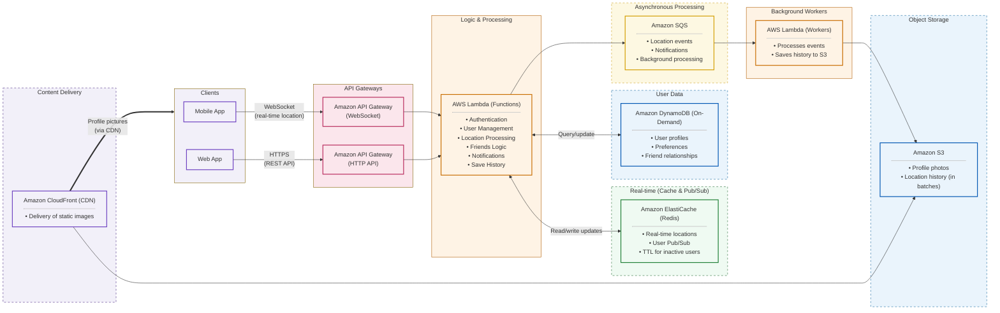

# Friends Nearby – Infrastructure

Terraform for the Friends Nearby AWS backend: clients talk to API Gateway (WebSocket for real-time location, HTTP for REST), which invokes Lambda. Lambda reads/writes Redis and DynamoDB and enqueues events to SQS; a worker Lambda batches history into S3; profile photos are served through CloudFront.

## Architecture

The same diagram lives in [`docs/architecture.mmd`](docs/architecture.mmd).



## Layout

```
infra/
├── main.tf            # wires the modules together
├── variables.tf       # region, project, environment, sizing
├── outputs.tf         # API URLs, CDN domain, bucket/queue names
├── versions.tf        # terraform + provider versions
├── src/               # Lambda source (placeholders)
│   ├── api.mjs
│   └── worker.mjs
├── docs/
│   └── architecture.mmd
└── modules/
    ├── network/       # VPC, private subnets, security groups, VPC endpoints (no NAT)
    ├── api/           # HTTP API + WebSocket API (routes, stages, throttling)
    ├── compute/       # Main API Lambda (in VPC) + SQS worker Lambda, IAM
    ├── cache/         # ElastiCache Redis (locations, pub/sub)
    ├── database/      # DynamoDB: users, friendships, ws connections
    ├── messaging/     # SQS events queue + DLQ
    └── storage/       # S3 media + history buckets, CloudFront CDN
```

## Usage

```sh
cd infra
terraform init
terraform plan
terraform apply
```

Override defaults with a `terraform.tfvars` (git-ignored), e.g. `environment = "prod"`.

## Notes

- Lambda code in `src/` is placeholder; replace with real app code.
- Redis TTL for inactive users (`location_ttl_seconds`) is passed to Lambda as `LOCATION_TTL_SECONDS`; the app sets it on each location write.
- The main Lambda runs in the VPC; it reaches S3/DynamoDB via free gateway endpoints and SQS/execute-api via interface endpoints (these cost money while running).
- State is local. Add an S3 backend before sharing.
- CORS defaults to `*`; restrict `cors_origins` for production.
